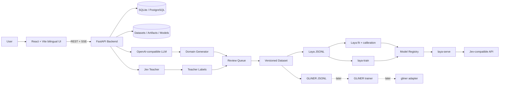

# AutoLaya Design

> Status: Phases 1–4 implemented  
> Repository: local-only, no GitHub remote  
> Primary target: Laya  
> Second target: GLiNER2.5-Decide (implemented)  
> Languages: English / 简体中文  
> Default LLM: DeepSeek (`deepseek-flash`) via OpenAI-compatible Chat Completions
>
> **Document note:** this file preserves the design and evolution record. Some “reserved / future” wording reflects earlier phases. Current behavior and operations are defined by [STATUS.md](STATUS.md) and the [User Guide](guide/en/README.md).

---

## 1. Summary

AutoLaya is a local-first platform for building domain decision models. It reuses the AutoYOLO workflow shape:

```text
domain prompt + seed examples
        → synthetic data generation
        → teacher labeling
        → human review
        → versioned dataset
        → target-model training
        → evaluation / calibration
        → local deployment
```

The first target model is **Laya**, a non-autoregressive System 1 decision engine with a Jev-compatible HTTP server. **GLiNER2.5-Decide** is the second trainable target and optional inference backend. Fine-tuning, evaluation, dataset export, and serving are implemented; GLiNER weak labeling remains optional future work.

The platform is text-decision focused. It does not replace Jev's image `Box` grounding.

---

## 2. Confirmed Decisions

| Topic | Decision |
|---|---|
| Repository | Local Git repo at `/home/jev-autoyolo/AutoLaya` |
| Remote | None; do not configure GitHub |
| Languages | Chinese and English |
| LLM channel | Any OpenAI-compatible Chat Completions API |
| Default LLM | DeepSeek `deepseek-flash` |
| Compute | CPU required; GPU optional |
| Target priority | Laya first |
| GLiNER | Second target with fine-tune, evaluation, export, and serving |
| Teacher | Jev primary; human review required |
| Serving | `laya-serve` with Jev-compatible `/v1/systemone` |
| Deployment | Local `deploy.sh`; no GitHub Actions |
| Secrets | Backend env only; never committed |

---

## 3. Goals

1. Generate domain-specific decision data from prompts and seed examples.
2. Label generated data with Jev and/or human reviewers.
3. Review, edit, reject, and version datasets.
4. Export directly to Laya training JSONL.
5. Support two Laya training paths:
   - `agent.fit` + calibration
   - `laya-train` full fine-tune
6. Evaluate and compare Jev and Laya.
7. Deploy a local Laya API compatible with Jev `/v1/systemone`.
8. Run on CPU; optionally CUDA, MPS, or ROCm.
9. Keep the UI and docs bilingual.
10. Reserve a clean adapter boundary for GLiNER.

## 4. Non-goals

- Replacing Jev's image `Box` detection.
- Building a general-purpose generative assistant.
- Claiming Laya zero-shot parity with Jev.
- Multi-tenant billing or hosted SaaS in Phase 1.
- Image/audio training in Phase 1.
- Using synthetic data as the only evaluation set.

---

## 5. Users and Workflows

### Users

- Annotation / ML teams building domain classifiers.
- Support / operations teams routing tickets, emails, reviews, or documents.
- Platform teams replacing selected Jev calls with a local model.

### Typical decisions

| Use case | Type | Example |
|---|---|---|
| Ticket routing | Choice | billing / technical / sales |
| Moderation | Choice / Noul | policy category / is spam |
| Urgency | Score | 0–5 |
| Intent | Choice | refund / cancel / status |
| Document type | Choice | invoice / contract / resume |
| Multi-label topics | Choice + multi-label | billing / safety / noise |
| Passage question | Noul | does the passage support the claim |

---

## 6. Architecture



### Runtime isolation

Laya and GLiNER have different dependency expectations. Use separate environments:

```text
backend/.venv        FastAPI, SQLAlchemy, orchestration, review
backend/laya-venv    Laya, torch, transformers
backend/gliner-venv  GLiNER2 training and serving
```

Large models run in worker subprocesses, never in the main API process.

---

## 7. Data Model

| Entity | Purpose |
|---|---|
| `Project` | One domain |
| `QuestionSchema` | Choice / Noul / Score definitions |
| `SeedSample` | User examples and labels |
| `GenerationJob` | LLM generation run |
| `Sample` | Generated or imported text/state |
| `Annotation` | Answer per sample/question |
| `DatasetSnapshot` | Versioned dataset and counts |
| `TargetModel` | Laya (first), GLiNER (second) |
| `TrainingJob` | fit / fine-tune run |
| `EvaluationRun` | Jev/Laya comparison |
| `ModelArtifact` | Checkpoint, calibration, metrics |
| `Deployment` | Running service instance |

### Key fields

```text
Project:
  id, name, domain, languages, created_at

QuestionSchema:
  id, project_id, key, type, instructions, criteria, order

SeedSample:
  id, project_id, state_json, labels_json, source, language

Sample:
  id, project_id, state_json, meta_json, source,
  generation_job_id, language, difficulty, status

Annotation:
  id, sample_id, question_id, answer_json,
  teacher, teacher_model, confidence, probabilities,
  status, reviewer, review_note, created_at

DatasetSnapshot:
  id, project_id, version, canonical_path,
  laya_path, gliner_path, split_counts, label_distribution,
  prompt_versions, teacher_models, created_at

TrainingJob:
  id, project_id, snapshot_id, target,
  mode, device, config_json, status, progress,
  metrics_json, artifact_path, error

Deployment:
  id, artifact_id, target, host, port,
  status, started_at, stopped_at
```

---

## 8. Canonical Dataset

All annotations first become a Canonical row.

```json
{
  "id": "sample-uuid",
  "state": {
    "ticket": "I was charged twice this month, please refund."
  },
  "questions": {
    "team": {
      "type": "choice",
      "instructions": "Which team should handle this ticket?",
      "criteria": {
        "billing": "Refunds, invoices, payments",
        "technical": "Bugs, outages, API issues",
        "sales": "Pricing, trials, quotes"
      }
    },
    "urgent": {
      "type": "noul",
      "instructions": "Does this need attention today?"
    }
  },
  "gold": {
    "team": {
      "choice": "billing",
      "confidence": 0.93,
      "probabilities": {
        "billing": 0.93,
        "technical": 0.05,
        "sales": 0.02
      }
    },
    "urgent": {
      "noul": 0.81
    }
  },
  "meta": {
    "language": "en",
    "source": "llm-generated",
    "teacher": "jev-1.14.0",
    "prompt_version": "domain-v1",
    "difficulty": "easy"
  }
}
```

### Laya export

```json
{
  "state": {"ticket": "I was charged twice..."},
  "questions": {"team": {"type": "choice", "...": "..."}},
  "expected": {"team": "billing"},
  "gold": {
    "team": {
      "probabilities": {
        "billing": 0.93,
        "technical": 0.05,
        "sales": 0.02
      }
    }
  }
}
```

`laya-train` accepts JSONL rows with `state`, `questions`, and `gold` or `expected`.

### GLiNER export

```json
{
  "input": "{\"ticket\":\"I was charged twice...\"}",
  "output": {
    "classifications": [
      {
        "task": "team",
        "labels": ["billing", "technical", "sales"],
        "true_label": ["billing"],
        "label_descriptions": {
          "billing": "Refunds, invoices, payments",
          "technical": "Bugs, outages, API issues",
          "sales": "Pricing, trials, quotes"
        }
      },
      {
        "task": "urgent",
        "labels": ["yes", "no"],
        "true_label": ["yes"]
      }
    ]
  }
}
```

GLiNER `Score` maps to ordinal labels in Phase 1 of GLiNER support. That is not a calibrated Jev score; document the limitation.

---

## 9. LLM-Generated Domain Data

### Inputs

- Domain description
- QuestionSchema
- Label descriptions
- 3–20 seed examples
- Language (`zh`, `en`, `both`)
- Target count
- Difficulty distribution
- Negative-sample ratio
- Optional label-balanced reverse generation

### Pipeline

1. **Schema suggestion**
   - LLM proposes questions, options, and descriptions.
   - User accepts or edits.

2. **State generation**
   - LLM generates text/JSON states only.
   - No final labels from the LLM by default.
   - Optional `teacher=llm` mode: the generator also emits weak labels in the same call.
   - LLM labels are marked `teacher=llm` and still require human review.
   - Support label-balanced reverse generation.
   - Include edge cases, negation, multi-intent, short/long text, and noise.
   - Generate Chinese and English separately when requested.

3. **Teacher labeling**
   - Jev is the primary teacher.
   - Human reviewers arbitrate.
   - GLiNER weak labels are reserved.

4. **Quality filters**
   - JSON Schema validation
   - Options must belong to the Schema
   - Empty/overlong filtering
   - Language detection
   - Exact and near deduplication
   - Teacher confidence thresholds
   - Disagreement routing to review
   - Label-distribution checks

5. **Human review**
   - Show state, question, teacher answer, confidence, disagreements.
   - Accept, edit, reject.
   - Record reviewer, reason, timestamp.

6. **Dataset versioning**
   - Split by seed/domain group.
   - Variants of one seed must not cross train/test.
   - Keep real held-out data.
   - Never use synthetic data as the only test set.

### OpenAI-compatible client

```text
OpenAICompatibleClient:
  base_url
  api_key
  model
  temperature
  max_tokens
  timeout
  max_concurrency
  retry policy
```

Default configuration:

```env
LLM_BASE_URL=https://api.deepseek.com
LLM_MODEL=deepseek-flash
LLM_API_KEY=
```

Compatible endpoints include DeepSeek, OpenRouter, OpenAI, vLLM, Ollama, and other `/v1/chat/completions` providers.

Use JSON mode when supported; otherwise parse JSON and retry on failure.

---

## 10. Teacher Labeling

### Jev

```text
POST /v1/systemone                 # TypeSafe
POST /v1/alpha/decisions           # OpenRouter Decisions
```

Store:

- `choice` / `noul` / `score`
- confidence
- probabilities
- model version
- usage

### Human

Final authority. Review queue is required even when Jev confidence is high.

### GLiNER

Weak labeler and cross-checker. Disagreement with Jev goes to human review.

---

## 11. Target Model Adapter

Common interface:

```python
class TargetModelAdapter:
    def prepare_dataset(snapshot) -> Path
    def fit(rows, config) -> Artifact
    def finetune(dataset, config) -> Artifact
    def evaluate(artifact, dataset) -> Metrics
    def serve(artifact, config) -> Deployment
```

### LayaAdapter (Phase 1)

- `laya.Agent.fit` + `save_calibration`
- `laya-train` subprocess
- `laya-serve` subprocess
- RLCD / soft-CE
- freeze encoder
- CPU / CUDA / MPS / ROCm

### GLiNERAdapter

- `AutoExtractor.from_pretrained`
- `ExtractorTrainer` + `TrainingConfig`
- JSONL classification data
- single / multi-label
- label descriptions
- ordinal labels
- LoRA optional
- custom normalized inference adapter
- optional Jev-compatible mapping for Choice/Noul/Score subsets

---

## 12. Laya Training

### Fit + calibration

For fast iteration and smaller datasets:

```python
agent = laya.Agent(vegaml=True)
report = agent.fit(rows, questions=questions)
agent.save_calibration("artifacts/project/calibration")
```

Artifacts:

- per-question heads
- temperature
- conformal threshold
- abstain/review thresholds
- fit report

### Full fine-tune

```bash
laya-train \
  --data dataset.jsonl \
  --base convaiinnovations/laya-typed-decisions \
  --out artifacts/project/laya-finetuned \
  --loss rlcd \
  --epochs 4 \
  --micro-batch 4 \
  --grad-accum 8 \
  --device auto
```

Configurable:

- loss
- epochs
- micro-batch
- gradient accumulation
- encoder/head learning rate
- max state length
- max question length
- shuffle options
- freeze encoder
- target error
- device

Training status:

```text
pending → running → completed
                  → failed
                  → cancelled
```

Progress is streamed over SSE.

---

## 13. Evaluation

Compare:

| Model | Source |
|---|---|
| Jev | TypeSafe / OpenRouter |
| Laya zero-shot | base checkpoint |
| Laya fit | fit artifact |
| Laya fine-tuned | `laya-train` artifact |
| GLiNER zero-shot | base checkpoint |
| GLiNER fine-tuned | fine-tune artifact |

Metrics:

- Accuracy
- Macro F1
- Per-question accuracy
- ECE
- Brier score
- Abstain rate
- Coverage
- Prediction set size
- Latency P50/P95
- Jev agreement

Keep separate real held-out data. Do not tune thresholds on the test set.

---

## 14. Serving

### Laya

```bash
LAYA_DEVICE=auto LAYA_PRELOAD=1 laya-serve
```

Endpoints:

```text
POST /v1/systemone
POST /v1/systemone/batch
```

Laya supports a Jev-compatible request/response shape.

### GLiNER

```text
POST /v1/classify
POST /v1/classify/batch
```

Optional Jev-compatible mapping only for supported decision types.

### Deployment manager

- Start / stop / restart
- Port allocation
- Health checks
- Model version selection
- Logs
- Idle unload
- Future API key protection

---

## 15. Frontend

Bilingual UI:

```text
frontend/src/i18n/locales/zh.json
frontend/src/i18n/locales/en.json
```

Pages:

1. Projects
2. Schema Builder
3. Seeds & Prompts
4. Generate
5. Review Queue
6. Dataset
7. Training
8. Evaluation
9. Models & Deploy
10. Settings

Key interactions:

- Token/cost estimate before generation
- Pause/cancel/resume generation
- Keyboard shortcuts in review
- Highlight Jev/human or Jev/GLiNER disagreements
- Label distribution charts
- SSE training progress
- CPU/GPU selector
- Target selector: Laya (GLiNER disabled until implemented)
- Export Canonical, Laya, and future GLiNER formats

---

## 16. Local Repository Layout

```text
AutoLaya/
├── README.md
├── README_ZH.md
├── deploy.sh
├── backend/
│   ├── app/
│   │   ├── api/routes/
│   │   ├── models/
│   │   ├── repositories/
│   │   └── services/
│   │       ├── llm/openai_compat.py
│   │       ├── teachers/jev.py
│   │       ├── teachers/gliner.py       # optional future weak labeler
│   │       ├── generation/
│   │       ├── datasets/
│   │       ├── targets/base.py
│   │       ├── targets/laya.py
│   │       ├── targets/gliner.py
│   │       ├── training/
│   │       ├── evaluation/
│   │       └── serving/
│   ├── laya-venv/
│   ├── gliner-venv/
│   └── tests/
├── frontend/
│   └── src/
├── docs/
│   ├── DESIGN.md
│   ├── DESIGN_ZH.md
│   ├── API.md
│   └── API_ZH.md
└── data/
    ├── uploads/
    ├── datasets/
    └── artifacts/
```

No remote is configured. No GitHub Actions are used.

---

## 17. CPU / GPU

- `device=auto` selects CUDA/ROCm → MPS → CPU.
- CPU is the default compatibility path.
- Laya fit/calibration and small inference should work on CPU.
- Full fine-tuning on CPU is supported technically but expected to be slow.
- GPU is recommended for full fine-tuning.
- GLiNER inference/training later follows the same device policy.
- Model runtimes use separate venvs to isolate dependencies.

---

## 18. Security and Privacy

- All keys live in `backend/.env`, which is gitignored.
- The frontend never receives provider keys.
- Logs redact secrets.
- Fully local mode supports Ollama/vLLM + Laya without external calls.
- Dataset retention policy is configurable.
- Synthetic samples are labeled with provenance.
- Human review records are retained for audit.
- No repository remote is configured in Phase 1.

---

## 19. Testing

### Unit

- Schema validation
- Prompt construction
- OpenAI-compatible response parsing
- Jev answer parsing
- Canonical → Laya conversion
- Future Canonical → GLiNER conversion
- Dataset splitting and deduplication
- Device selection
- Target adapter contracts

### Integration

- Generate → annotate → review → dataset
- Laya `fit` dry-run
- `laya-train --dry-run`
- `laya-serve` health
- `/v1/systemone` compatibility
- Future GLiNER `ExtractorTrainer` dry-run

### CPU / GPU

- CPU inference smoke test
- Fit/calibration on CPU
- Optional CUDA/MPS/ROCm validation

### Frontend

- Chinese/English switching
- Schema Builder
- Review Queue
- Training SSE
- Evaluation table
- Deployment status

---

## 20. Implementation Phases

### Phase 0 — Documentation and local repo

- Local repo (no remote)
- README / README_ZH
- DESIGN / DESIGN_ZH
- API / API_ZH
- `.env.example`, `.gitignore`

### Phase 1 — Data loop

- FastAPI + React + SQLite
- Project / QuestionSchema / SeedSample
- Sample review
- Canonical dataset
- Laya JSONL export
- `deploy.sh`

### Phase 2 — Generation and teacher

- OpenAI-compatible LLM client (DeepSeek default)
- Prompt templates
- Generation jobs + SSE
- Jev teacher
- Quality filters and disagreement routing
- Dataset versioning

### Phase 3 — Laya target

- `agent.fit` + calibration
- `laya-train`
- Evaluation
- `laya-serve`
- Model registry

### Phase 4 — GLiNER target

- Separate `gliner-venv`
- `AutoExtractor`
- `ExtractorTrainer`
- GLiNER JSONL export
- Normalized serve
- Evaluation

### Phase 5 — Bilingual polish and release readiness

- Full EN/ZH UI and docs
- CPU/GPU matrix
- Security audit
- Local deployment verification

---

## 21. Acceptance Criteria

- Local repo runs without a GitHub remote.
- Bilingual UI and documentation.
- Any OpenAI-compatible Chat Completions endpoint can be configured.
- CPU works; GPU is optional.
- Laya is the complete first target.
- GLiNER fine-tuning, evaluation, export, and serving work without blocking Laya.
- Dataset exports to Laya JSONL.
- Generate → review → export → train → evaluate → serve works end to end.
- Keys never appear in frontend, logs, or Git.
- Real held-out data remains part of evaluation.

---

## 22. Risks

| Risk | Mitigation |
|---|---|
| LLM-generated data is unrealistic | Seed anchoring, stratified generation, human review |
| Jev cost/latency | Cache, batch, budget limits |
| Laya zero-shot is weak | Rely on fit/fine-tune, set expectations |
| GLiNER dependency conflict | Separate venv/process |
| Synthetic leakage | Group splits by seed/domain |
| CPU fine-tuning too slow | Default fit/small tests on CPU; warn for full fine-tune |
| GLiNER English-only | Reserve multi-Decide option and document limits |
| Probability mismatch | Evaluate calibration; do not transfer Jev thresholds |

---

## 23. Open Questions

1. Should the default UI language follow the browser or start in Chinese?
2. Should DeepSeek be the only default LLM, or should the settings page expose provider presets?
3. What is the maximum synthetic dataset size for the first release?
4. Which real held-out data can be used for the first domain?
5. When GLiNER is enabled later, should it be trained alongside Laya or only used as a baseline?

---

## 24. Immediate Next Step

After this design is accepted:

1. Create the local repository skeleton.
2. Write README and design docs.
3. Implement Phase 1 data models and review/export flow.
4. Add Laya JSONL export.
5. Stop before LLM/Jev integration for review.
