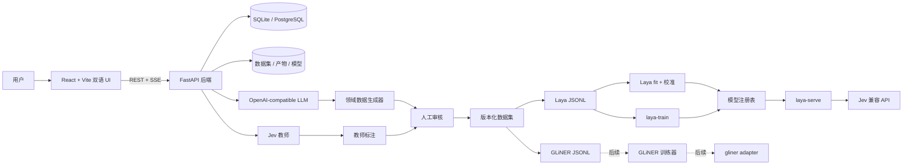

# AutoLaya 设计文档

> 状态：阶段 1–4 已实现  
> 仓库：仅本地，不配置 GitHub remote  
> 首选目标：Laya  
> 第二目标：GLiNER2.5-Decide（已实现）  
> 语言：中文 / English  
> 默认 LLM：DeepSeek（`deepseek-flash`），通过 OpenAI-compatible Chat Completions 调用
>
> **文档说明：** 本文保留设计与演进记录。文中个别“预留 / 后续”表述是早期阶段用语；当前实际能力和操作步骤以 [STATUS_ZH.md](STATUS_ZH.md) 与 [用户指南](guide/README.md) 为准。

---

## 1. 概述

AutoLaya 是一个本地优先的领域决策模型构建平台，沿用 AutoYOLO 的工作流形态：

```text
领域 Prompt + 种子样题
        → LLM 生成数据
        → 教师标注
        → 人工审核
        → 版本化数据集
        → 目标模型训练
        → 评估 / 校准
        → 本地部署
```

首个训练目标是 **Laya**，一个非自回归 System 1 决策引擎，提供 Jev 兼容 HTTP 服务。**GLiNER2.5-Decide** 作为第二个可训练目标和可选推理后端，已实现微调、评估、数据导出和部署；GLiNER 弱标注仍作为后续可选项。

平台聚焦文本决策，不替代 Jev 的图像 `Box` 定位。

---

## 2. 已确认设计决策

| 主题 | 决策 |
|---|---|
| 仓库 | 本地 Git 仓库：`/home/jev-autoyolo/AutoLaya` |
| 远程 | 不配置 GitHub remote |
| 语言 | 中文 / English |
| LLM 渠道 | 所有 OpenAI-compatible Chat Completions API |
| 默认 LLM | DeepSeek `deepseek-flash` |
| 计算 | 必选 CPU，GPU 可选 |
| 目标优先级 | 先 Laya |
| GLiNER | 第二目标，支持微调、评估、导出和部署 |
| 教师 | Jev 为主，人工审核必须保留 |
| 服务 | `laya-serve`，提供 Jev 兼容 `/v1/systemone` |
| 部署 | 本地 `deploy.sh`，不使用 GitHub Actions |
| 密钥 | 仅后端环境变量，禁止提交 |

---

## 3. 目标

1. 根据领域 Prompt 和种子样题生成领域数据
2. 使用 Jev 和/或人工标注生成数据
3. 支持审核、修改、拒绝和数据集版本化
4. 导出 Laya 可直接训练的 JSONL
5. 支持两种 Laya 训练路径：
   - `agent.fit` + 校准
   - `laya-train` 全量微调
6. 评估并对比 Jev 与 Laya
7. 部署本地 Laya API，兼容 Jev `/v1/systemone`
8. 支持 CPU，可选 CUDA / MPS / ROCm
9. UI 和文档中英双语
10. 为 GLiNER 预留干净的适配器边界

## 4. 非目标

- 不替代 Jev 的图像 Box 检测
- 不做通用生成式助手
- 不承诺 Laya zero-shot 达到 Jev 水平
- 首期不做多租户计费和 SaaS
- 首期不做图像/音频训练
- 合成数据不能作为唯一评估集

---

## 5. 用户与场景

### 用户

- 标注 / 算法团队：构建领域分类、路由、审核模型
- 客服 / 运营团队：将工单、邮件、评论、文档转成结构化决策
- 平台团队：用本地 Laya 替换部分 Jev 调用

### 典型决策

| 场景 | 类型 | 示例 |
|---|---|---|
| 工单路由 | Choice | billing / technical / sales |
| 内容审核 | Choice / Noul | 政策分类 / 是否垃圾 |
| 紧急程度 | Score | 0–5 |
| 意图识别 | Choice | 退款 / 取消 / 查询 |
| 文档类型 | Choice | invoice / contract / resume |
| 多标签主题 | Choice + multi-label | billing / safety / noise |
| 段落判断 | Noul | 段落是否支持结论 |

---

## 6. 系统架构



### 运行时隔离

Laya 与 GLiNER 依赖不同，使用独立环境：

```text
backend/.venv        FastAPI、SQLAlchemy、编排、审核
backend/laya-venv    Laya、torch、transformers
backend/gliner-venv  GLiNER2 训练与部署
```

大模型只在 worker 子进程运行，不进入主 API 进程。

---

## 7. 数据模型

| 实体 | 作用 |
|---|---|
| `Project` | 一个领域 |
| `QuestionSchema` | Choice / Noul / Score 定义 |
| `SeedSample` | 用户样题和标签 |
| `GenerationJob` | LLM 生成任务 |
| `Sample` | 生成或导入的文本/state |
| `Annotation` | 某样本某题的答案 |
| `DatasetSnapshot` | 版本化数据集和统计 |
| `TargetModel` | Laya（首选）、GLiNER（预留） |
| `TrainingJob` | fit / fine-tune 任务 |
| `EvaluationRun` | Jev/Laya 对比 |
| `ModelArtifact` | checkpoint、校准、指标 |
| `Deployment` | 运行中的服务 |

### 关键字段

```text
Project:
  id, name, domain, languages, created_at

QuestionSchema:
  id, project_id, key, type, instructions, criteria, order

SeedSample:
  id, project_id, state_json, labels_json, source, language

Sample:
  id, project_id, state_json, meta_json, source,
  generation_job_id, language, difficulty, status

Annotation:
  id, sample_id, question_id, answer_json,
  teacher, teacher_model, confidence, probabilities,
  status, reviewer, review_note, created_at

DatasetSnapshot:
  id, project_id, version, canonical_path,
  laya_path, gliner_path, split_counts, label_distribution,
  prompt_versions, teacher_models, created_at

TrainingJob:
  id, project_id, snapshot_id, target,
  mode, device, config_json, status, progress,
  metrics_json, artifact_path, error

Deployment:
  id, artifact_id, target, host, port,
  status, started_at, stopped_at
```

---

## 8. Canonical 数据集

所有标注先进入统一格式。

```json
{
  "id": "sample-uuid",
  "state": {
    "ticket": "I was charged twice this month, please refund."
  },
  "questions": {
    "team": {
      "type": "choice",
      "instructions": "Which team should handle this ticket?",
      "criteria": {
        "billing": "Refunds, invoices, payments",
        "technical": "Bugs, outages, API issues",
        "sales": "Pricing, trials, quotes"
      }
    },
    "urgent": {
      "type": "noul",
      "instructions": "Does this need attention today?"
    }
  },
  "gold": {
    "team": {
      "choice": "billing",
      "confidence": 0.93,
      "probabilities": {
        "billing": 0.93,
        "technical": 0.05,
        "sales": 0.02
      }
    },
    "urgent": {
      "noul": 0.81
    }
  },
  "meta": {
    "language": "en",
    "source": "llm-generated",
    "teacher": "jev-1.14.0",
    "prompt_version": "domain-v1",
    "difficulty": "easy"
  }
}
```

### Laya 导出

```json
{
  "state": {"ticket": "I was charged twice..."},
  "questions": {"team": {"type": "choice", "...": "..."}},
  "expected": {"team": "billing"},
  "gold": {
    "team": {
      "probabilities": {
        "billing": 0.93,
        "technical": 0.05,
        "sales": 0.02
      }
    }
  }
}
```

`laya-train` 接受带 `state`、`questions` 和 `gold` 或 `expected` 的 JSONL。

### GLiNER 导出（预留）

```json
{
  "input": "{\"ticket\":\"I was charged twice...\"}",
  "output": {
    "classifications": [
      {
        "task": "team",
        "labels": ["billing", "technical", "sales"],
        "true_label": ["billing"],
        "label_descriptions": {
          "billing": "Refunds, invoices, payments",
          "technical": "Bugs, outages, API issues",
          "sales": "Pricing, trials, quotes"
        }
      },
      {
        "task": "urgent",
        "labels": ["yes", "no"],
        "true_label": ["yes"]
      }
    ]
  }
}
```

GLiNER 的 `Score` 首期映射为 ordinal 标签，不是 Jev 原生 calibrated score，需要在 UI 和文档中标注限制。

---

## 9. LLM 自动生成领域数据

### 输入

- 领域描述
- QuestionSchema
- 标签说明
- 3–20 条种子样题
- 语言：`zh` / `en` / `both`
- 目标数量
- 难度分布
- 负样本比例
- 可选标签均衡反向生成

### 流程

1. **Schema 建议**
   - LLM 提出题目、选项、描述
   - 用户确认或修改

2. **State 生成**
   - 默认只生成文本/JSON state，不生成最终标签
   - 可选 `teacher=llm` 模式：生成时同时输出弱标签，标记为 `teacher=llm`，仍需人工审核
   - 支持按标签反向生成，保证类别均衡
   - 覆盖边界、否定、多意图、短文本、长文本、噪声
   - 中文和英文分别生成

3. **教师标注**
   - Jev 为主教师
   - 人工最终仲裁
   - GLiNER 弱标注预留

4. **质量过滤**
   - JSON Schema 校验
   - 选项必须属于 Schema
   - 空文本/超长过滤
   - 语言检测
   - 精确/近似去重
   - 教师置信度阈值
   - 分歧样本进入审核
   - 标签分布检查

5. **人工审核**
   - 展示 state、题目、教师答案、置信度、分歧
   - 通过 / 修改 / 拒绝
   - 记录审核人、原因、时间

6. **数据集版本**
   - 按 seed/领域分组切分
   - 同一 seed 变体不能跨 train/test
   - 保留真实 held-out 数据
   - 合成数据不能作为唯一测试集

### OpenAI-compatible 客户端

```text
OpenAICompatibleClient:
  base_url
  api_key
  model
  temperature
  max_tokens
  timeout
  max_concurrency
  retry policy
```

默认配置：

```env
LLM_BASE_URL=https://api.deepseek.com
LLM_MODEL=deepseek-flash
LLM_API_KEY=
```

支持 DeepSeek、OpenRouter、OpenAI、vLLM、Ollama 以及其他兼容 `/v1/chat/completions` 的端点。

优先使用 JSON mode；不支持时解析 JSON，失败自动重试并记录原始输出。

---

## 10. 教师标注

### Jev

```text
POST /v1/systemone                 # TypeSafe
POST /v1/alpha/decisions           # OpenRouter Decisions
```

保存：

- `choice` / `noul` / `score`
- confidence
- probabilities
- model version
- usage

### 人工

最终权威。即使 Jev 置信度高，也需要保留人工审核能力。

### GLiNER（预留）

弱标注器和交叉验证器。与 Jev 分歧时进入人工审核。

---

## 11. 目标模型 Adapter

统一接口：

```python
class TargetModelAdapter:
    def prepare_dataset(snapshot) -> Path
    def fit(rows, config) -> Artifact
    def finetune(dataset, config) -> Artifact
    def evaluate(artifact, dataset) -> Metrics
    def serve(artifact, config) -> Deployment
```

### LayaAdapter（Phase 1）

- `laya.Agent.fit` + `save_calibration`
- `laya-train` 子进程
- `laya-serve` 子进程
- RLCD / soft-CE
- freeze encoder
- CPU / CUDA / MPS / ROCm

### GLiNERAdapter（预留）

- `AutoExtractor.from_pretrained`
- `ExtractorTrainer` + `TrainingConfig`
- JSONL 分类数据
- 单标签 / 多标签
- label descriptions
- ordinal 标签
- 可选 LoRA
- 自定义 normalized 推理 adapter
- 可选 Jev-compatible 子集映射

---

## 12. Laya 训练

### Fit + 校准

适合快速迭代和小数据集：

```python
agent = laya.Agent(vegaml=True)
report = agent.fit(rows, questions=questions)
agent.save_calibration("artifacts/project/calibration")
```

产物：

- 每问题 heads
- temperature
- conformal threshold
- abstain/review 阈值
- fit 报告

### 全量微调

```bash
laya-train \
  --data dataset.jsonl \
  --base convaiinnovations/laya-typed-decisions \
  --out artifacts/project/laya-finetuned \
  --loss rlcd \
  --epochs 4 \
  --micro-batch 4 \
  --grad-accum 8 \
  --device auto
```

可配置：

- loss
- epochs
- micro-batch
- gradient accumulation
- encoder/head learning rate
- max state length
- max question length
- shuffle options
- freeze encoder
- target error
- device

训练状态：

```text
pending → running → completed
                  → failed
                  → cancelled
```

进度通过 SSE 推送。

---

## 13. 评估

对比：

| 模型 | 来源 |
|---|---|
| Jev | TypeSafe / OpenRouter |
| Laya zero-shot | 基础 checkpoint |
| Laya fit | fit 产物 |
| Laya fine-tuned | `laya-train` 产物 |
| GLiNER zero-shot | 预留 |
| GLiNER fine-tuned | 预留 |

指标：

- Accuracy
- Macro F1
- Per-question accuracy
- ECE
- Brier score
- Abstain rate
- Coverage
- Prediction set size
- Latency P50/P95
- Jev agreement

保留独立真实 held-out 数据，禁止在测试集上调阈值。

---

## 14. 部署

### Laya

```bash
LAYA_DEVICE=auto LAYA_PRELOAD=1 laya-serve
```

接口：

```text
POST /v1/systemone
POST /v1/systemone/batch
```

Laya 支持 Jev 兼容的请求/响应结构。

### GLiNER（预留）

```text
POST /v1/classify
POST /v1/classify/batch
```

可选的 Jev-compatible 映射只覆盖支持的决策类型。

### 部署管理

- 启动 / 停止 / 重启
- 端口分配
- 健康检查
- 模型版本选择
- 日志
- 空闲卸载
- 后续 API Key 保护

---

## 15. 前端

双语 UI：

```text
frontend/src/i18n/locales/zh.json
frontend/src/i18n/locales/en.json
```

页面：

1. Projects
2. Schema Builder
3. Seeds & Prompts
4. Generate
5. Review Queue
6. Dataset
7. Training
8. Evaluation
9. Models & Deploy
10. Settings

关键交互：

- 生成前显示 token/成本估算
- 生成任务暂停/取消/续跑
- 审核页键盘快捷键
- Jev/人工或 Jev/GLiNER 分歧高亮
- 标签分布图表
- 训练 SSE 进度
- CPU/GPU 选择
- 目标模型选择：Laya（GLiNER 在实现前禁用）
- 导出 Canonical、Laya 和未来 GLiNER 格式

---

## 16. 本地仓库结构

```text
AutoLaya/
├── README.md
├── README_ZH.md
├── deploy.sh
├── backend/
│   ├── app/
│   │   ├── api/routes/
│   │   ├── models/
│   │   ├── repositories/
│   │   └── services/
│   │       ├── llm/openai_compat.py
│   │       ├── teachers/jev.py
│   │       ├── teachers/gliner.py       # 预留
│   │       ├── generation/
│   │       ├── datasets/
│   │       ├── targets/base.py
│   │       ├── targets/laya.py
│   │       ├── targets/gliner.py        # 预留
│   │       ├── training/
│   │       ├── evaluation/
│   │       └── serving/
│   ├── laya-venv/
│   ├── gliner-venv/                     # 预留
│   └── tests/
├── frontend/
│   └── src/
├── docs/
│   ├── DESIGN.md
│   ├── DESIGN_ZH.md
│   ├── API.md
│   └── API_ZH.md
└── data/
    ├── uploads/
    ├── datasets/
    └── artifacts/
```

不配置 remote，不使用 GitHub Actions。

---

## 17. CPU / GPU

- `device=auto`：CUDA/ROCm → MPS → CPU
- 默认兼容 CPU
- Laya fit/校准和小规模推理应可在 CPU 运行
- CPU 全量微调技术上支持，但速度较慢
- 全量微调推荐 GPU
- GLiNER 后续遵循相同设备策略
- 模型运行时使用独立 venv 隔离依赖

---

## 18. 安全与隐私

- 所有 Key 放在 `backend/.env`，gitignore
- 前端不接触 Provider Key
- 日志脱敏
- 完全本地模式支持 Ollama/vLLM + Laya，无外部调用
- 支持数据集保留期限
- 合成样本记录来源
- 人工审核记录保留审计信息
- Phase 1 不配置仓库 remote

---

## 19. 测试

### 单元

- Schema 校验
- Prompt 构造
- OpenAI-compatible 响应解析
- Jev 答案解析
- Canonical → Laya 转换
- 未来 Canonical → GLiNER 转换
- 数据切分和去重
- Device 选择
- Target adapter 合约

### 集成

- 生成 → 标注 → 审核 → 数据集
- Laya `fit` dry-run
- `laya-train --dry-run`
- `laya-serve` health
- `/v1/systemone` 兼容
- 未来 GLiNER `ExtractorTrainer` dry-run

### CPU / GPU

- CPU 推理 smoke test
- CPU fit/校准
- 可选 CUDA/MPS/ROCm 验证

### 前端

- 中英切换
- Schema Builder
- Review Queue
- Training SSE
- Evaluation 表格
- Deployment 状态

---

## 20. 实施阶段

### Phase 0 — 文档与本地仓库

- 本地仓库（无 remote）
- README / README_ZH
- DESIGN / DESIGN_ZH
- API / API_ZH
- `.env.example`、`.gitignore`

### Phase 1 — 数据流程

- FastAPI + React + SQLite
- Project / QuestionSchema / SeedSample
- 样本审核
- Canonical 数据集
- Laya JSONL 导出
- `deploy.sh`

### Phase 2 — 生成与教师

- OpenAI-compatible LLM 客户端（默认 DeepSeek）
- Prompt 模板
- 生成任务 + SSE
- Jev 教师
- 质量过滤与分歧路由
- 数据集版本

### Phase 3 — Laya Target

- `agent.fit` + 校准
- `laya-train`
- 评估
- `laya-serve`
- 模型注册表

### Phase 4 — GLiNER Target

- 独立 `gliner-venv`
- `AutoExtractor`
- `ExtractorTrainer`
- GLiNER JSONL 导出
- Normalized serve
- 评估

### Phase 5 — 双语与发布准备

- 完整 EN/ZH UI 和文档
- CPU/GPU 矩阵
- 安全审计
- 本地部署验证

---

## 21. 验收标准

- 本地仓库无需 GitHub remote 可运行
- 中英双语 UI 和文档
- 任意 OpenAI-compatible Chat Completions 端点可配置
- CPU 可用，GPU 可选
- Laya 是首个完整目标
- GLiNER 接口和格式预留，不阻塞 Laya
- 数据集可导出 Laya JSONL
- 完成生成 → 审核 → 导出 → 训练 → 评估 → 部署
- Key 不出现在前端、日志或 Git
- 真实 held-out 数据参与评估

---

## 22. 风险

| 风险 | 缓解 |
|---|---|
| LLM 生成数据不真实 | 种子锚定、分层生成、人工审核 |
| Jev 成本/延迟 | 缓存、批量、预算上限 |
| Laya zero-shot 弱 | 以 fit/微调为主，明确预期 |
| GLiNER 依赖冲突 | 独立 venv/进程 |
| 合成数据泄漏 | 按 seed/领域分组切分 |
| CPU 微调慢 | 默认 CPU 只跑 fit/小测试；全量微调提示 GPU |
| GLiNER 仅英文 | 预留 multi-Decide 选项并标注限制 |
| 概率口径不同 | 重新评估校准，不直接搬 Jev 阈值 |

---

## 23. 待确认问题

1. 默认 UI 语言跟随浏览器，还是固定中文？
2. DeepSeek 是唯一默认 LLM，还是设置页提供 Provider 预设？
3. 首个版本合成数据集上限是多少？
4. 首个领域可以使用哪些真实 held-out 数据？
5. GLiNER 实现后，是与 Laya 并行训练，还是只作为 baseline？

---

## 24. 下一步

设计通过后：

1. 创建本地仓库骨架
2. 写入 README 和设计文档
3. 实现 Phase 1 数据模型与审核/导出闭环
4. 增加 Laya JSONL 导出
5. 在 LLM/Jev 集成前停下，等待评审
